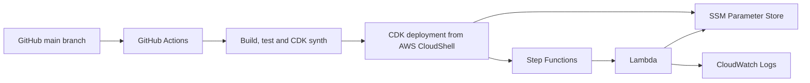

# AWS Serverless Workflow Platform

**Capstone:** Multi-Account, Automated, and Governed Cloud Platform  
**Stack:** AWS CDK (TypeScript), GitHub Actions, Step Functions, Lambda, Systems Manager Parameter Store and CloudWatch.

## Objective

This project provisions a serverless workflow platform using AWS CDK. Step Functions orchestrates the workflow. A Lambda function retrieves a greeting from SSM Parameter Store and writes a structured event to CloudWatch Logs. GitHub Actions automatically builds, tests and synthesizes the infrastructure on pushes and pull requests.

The lab deployment uses the single AWS Academy account available to the student. The infrastructure is defined as code and can be deployed into another account when a separately provisioned account and appropriate permissions are available. This repository does not claim a completed second-account deployment.

## Architecture



## Main deliverables

- Infrastructure as Code using AWS CDK and TypeScript.
- Automated build, tests and CDK synthesis through GitHub Actions.
- Step Functions workflow orchestration.
- Lambda serverless compute.
- SSM Parameter Store configuration management.
- Least-privilege IAM access to the greeting parameter.
- CloudWatch execution and application logs.

## Repository layout

- `bin/app.ts`: CDK application entry point.
- `lib/workflow-stack.ts`: SSM parameter, Lambda, IAM permissions and Step Functions.
- `lambda/greeting/`: Lambda handler and AWS SDK dependency.
- `test/`: infrastructure assertions.
- `.github/workflows/ci.yml`: automated validation workflow.
- `docs/`: deployment and governance notes.

## Deploy

See [docs/deployment.md](docs/deployment.md) for detailed instructions. In AWS CloudShell, select US West (Oregon), then run:

```bash
git clone https://github.com/RURIGIMK/aws-serverless-workflow-platform.git
cd aws-serverless-workflow-platform
npm install
cd lambda/greeting && npm install --omit=dev && cd ../..
npm run build
npm test -- --runInBand
npx cdk bootstrap
npm run deploy
```

Review the CloudFormation changes before approving deployment.

## Verify

1. Confirm Step Functions state machine `serverless-greeting-workflow` exists.
2. Confirm Lambda function `serverless-workflow-greeting` exists.
3. Confirm SSM parameter `/app/config/greeting` exists.
4. Start an execution with:

```json
{
  "source": "manual-capstone-test"
}
```

5. Confirm the execution succeeds.
6. Inspect `/aws/lambda/serverless-workflow-greeting` for the `SSM_PARAMETER_READ` event.

## Security and governance

- Lambda's SSM read permission is scoped to the single greeting parameter.
- The greeting is non-sensitive configuration, not a secret.
- The workflow uses a Standard Step Functions state machine with logging and tracing.
- CloudWatch log groups have one-week retention.
- Infrastructure changes are version-controlled and automatically validated before deployment.
- The available lab account is used for deployment. A second-account deployment is not claimed unless it is actually provisioned and tested.

## Cost control

The project does not create a VPC, NAT Gateway, load balancer or always-on compute. AWS service usage may still incur charges. Review account allowances and remove the lab stack after assessment if instructed.

## Evidence screenshots

Capture actual screenshots after deployment:

- `docs/evidence/01-github-actions-success.png`: successful GitHub Actions validation run.
- `docs/evidence/02-step-functions-success.png`: successful Step Functions execution graph.
- `docs/evidence/03-lambda-ssm-cloudwatch-logs.png`: Lambda log stream showing the SSM retrieval event.

Do not use mockups or fabricated evidence.

## Submission

https://github.com/RURIGIMK/aws-serverless-workflow-platform
