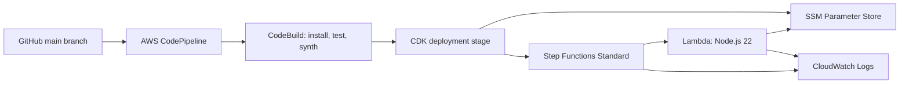

# AWS Serverless Workflow Platform

**Capstone:** Multi-Account, Automated, and Governed Cloud Platform  
**Stack:** AWS CDK (TypeScript), CodePipeline, CodeBuild, Step Functions, Lambda, Systems Manager Parameter Store and CloudWatch.

## Objective

This repository provisions a repeatable serverless workflow platform. A push to `main` triggers a CDK Pipeline. The pipeline synthesizes and tests the infrastructure, then deploys the application stack. The Step Functions workflow starts with a preparation state and invokes a Lambda function. Lambda retrieves `/app/config/greeting` from SSM Parameter Store at runtime and writes a structured log entry to CloudWatch.

The deployment is multi-account-ready: the application stage is a CDK Stage with an explicit target account and region. The default target is the pipeline account. A separate target account can be selected at deployment time after the required CDK bootstrap trust is configured. Do not describe this as a completed multi-account deployment unless a second account has actually been configured and deployed.

## Architecture



## Repository layout

- `bin/app.ts`: CDK application entry point and required environment configuration.
- `lib/pipeline-stack.ts`: GitHub-connected, self-mutating CDK Pipeline.
- `lib/workflow-stack.ts`: SSM parameter, Lambda function, IAM permissions and Step Functions state machine.
- `lambda/greeting/`: Lambda handler and its AWS SDK v3 dependency.
- `test/`: infrastructure assertions.
- `docs/`: deployment and governance notes.

## Prerequisites

- An AWS account with permissions to create CloudFormation, IAM roles and policies, CodePipeline, CodeBuild, CodeConnections, Lambda, Step Functions, SSM and CloudWatch resources.
- AWS CLI v2 configured for the intended pipeline account.
- Node.js 22 or later and npm.
- AWS CDK v2.
- A public GitHub repository: [RURIGIMK/aws-serverless-workflow-platform](https://github.com/RURIGIMK/aws-serverless-workflow-platform).

Check the active AWS identity before deploying:

```bash
aws sts get-caller-identity
aws configure get region
node --version
npm --version
```

Use the intended lab region consistently. The examples below use `us-west-2`; change it only if your lab instructions specify another region.

## Phase 1: Install and validate locally

Clone the repository and install the root dependencies:

```bash
git clone https://github.com/RURIGIMK/aws-serverless-workflow-platform.git
cd aws-serverless-workflow-platform
npm install
npm run build
npm test -- --runInBand
```

Install the Lambda's packaged dependency:

```bash
cd lambda/greeting
npm install --omit=dev
cd ../..
```

## Phase 2: Create the GitHub source connection

1. Open the AWS Console and select the intended pipeline region.
2. Open **Developer Tools → Settings → Connections** (CodeConnections; older console labels may say CodeStar Connections).
3. Choose **Create connection**.
4. Select **GitHub** as the provider and name it `serverless-workflow-github`.
5. Choose **Connect to GitHub** and complete the GitHub authorization flow for this repository.
6. Return to AWS and choose **Install a new app** or select the existing AWS Connector for GitHub installation. Grant access to this repository only where the installation screen permits.
7. Finish the connection and wait until its status is **Available**.
8. Copy the complete connection ARN. It has the form `arn:aws:codestar-connections:REGION:ACCOUNT:connection/UUID`.

Do not paste personal access tokens, AWS access keys or secrets into this repository.

## Phase 3: Bootstrap and deploy the pipeline

From the repository root, set the values for the account and region shown by `aws sts get-caller-identity` and your selected AWS Console region:

```bash
export CDK_DEFAULT_ACCOUNT="$(aws sts get-caller-identity --query Account --output text)"
export CDK_DEFAULT_REGION="us-west-2"
export GITHUB_CONNECTION_ARN="PASTE_THE_AVAILABLE_CONNECTION_ARN"
```

Bootstrap the pipeline account once:

```bash
npx cdk bootstrap aws://$CDK_DEFAULT_ACCOUNT/$CDK_DEFAULT_REGION
```

Deploy the pipeline stack:

```bash
npm run deploy:pipeline
```

Review the CloudFormation changeset and approve deployment when prompted. The first deployment creates the pipeline. The pipeline then self-mutates and deploys the application stage. A subsequent push to `main` triggers the pipeline automatically.

### Optional separate target account

For a genuinely separate application account, bootstrap that account in the target region while trusting the pipeline account, following the current CDK bootstrap trust guidance. Then deploy the pipeline stack with the target account context:

```bash
npx cdk deploy WorkflowPipelineStack \
  -c targetAccount=TARGET_ACCOUNT_ID \
  -c targetRegion=TARGET_REGION
```

The pipeline account and target account must be accessible through the configured AWS credentials/bootstrap trust. If the lab provides only one account, use the default same-account deployment and document the multi-account-ready design accurately. Do not invent or use an account ID.

## Phase 4: Verify the deployed resources

In the AWS Console, confirm:

1. **CodePipeline:** pipeline `serverless-workflow-platform` has completed its source, synth and deployment actions successfully.
2. **CloudFormation:** the pipeline application stage has created the workflow stack.
3. **Systems Manager → Parameter Store:** parameter `/app/config/greeting` exists and has type `String`.
4. **Lambda:** function `serverless-workflow-greeting` exists.
5. **Step Functions:** state machine `serverless-greeting-workflow` exists and is Standard.

## Phase 5: Manually execute the state machine

1. Open **Step Functions → State machines**.
2. Select `serverless-greeting-workflow`.
3. Choose **Start execution**.
4. Use this valid JSON input:

```json
{
  "source": "manual-capstone-test"
}
```

5. Name the execution `capstone-manual-validation` if the console asks for an execution name.
6. Start the execution and wait for **Succeeded**.
7. Open the execution graph. Confirm that `PrepareWorkflow` completed and `ReadGreetingFromParameterStore` succeeded.

The Lambda response includes the retrieved greeting and parameter name.

## Phase 6: Verify runtime logging

1. Open **CloudWatch → Logs → Log groups**.
2. Open `/aws/lambda/serverless-workflow-greeting`.
3. Open the newest log stream created by the manual execution.
4. Confirm the structured log contains `SSM_PARAMETER_READ`, `/app/config/greeting` and the greeting value.

## Security and governance controls

- The Lambda role receives parameter read access through CDK's `grantRead` for the single parameter. It does not receive broad `ssm:*` access.
- The parameter is a non-secret String configuration value. Never store credentials or secrets in this parameter.
- The workflow uses a Standard state machine with execution logging and X-Ray tracing enabled.
- The Lambda and Step Functions log groups retain logs for one week to limit storage cost.
- The pipeline is source-controlled and self-mutating. Changes to infrastructure are reviewed as Git commits before deployment.
- For a separate target account, use CDK bootstrap trust and explicit target account/region configuration. Keep administrative and deployment permissions separated where the lab account permits.
- The lab default is a single-account deployment unless a second account is actually configured.

## Cost notes

The project uses managed, on-demand services and does not create a VPC, NAT Gateway, load balancer or always-on compute. CodePipeline, CodeBuild, Lambda, Step Functions, CloudWatch Logs, SSM Parameter Store and KMS usage may incur charges depending on region, execution volume and account allowances. Review current pricing and delete the lab stacks after assessment if instructed.

## Evidence screenshots

Add the final evidence images to `docs/evidence/` after the deployment and manual execution have succeeded:

- `01-codepipeline-success.png`: successful pipeline execution with source, synth/build and deployment stages visible.
- `02-step-functions-success.png`: successful execution graph showing both workflow states.
- `03-lambda-ssm-cloudwatch-logs.png`: Lambda log stream showing the SSM retrieval event and parameter name.

Screenshots must show actual results from the deployed account. Do not use mockups or fabricated evidence.

## Troubleshooting

- **Connection is not Available:** return to CodeConnections, complete the GitHub app installation and wait for the status to become Available.
- **CDK bootstrap required:** bootstrap the account/region used by the pipeline before deploying the pipeline stack.
- **AccessDenied for SSM:** inspect the Lambda execution role and verify the parameter ARN matches `/app/config/greeting` in the deployed region/account.
- **Pipeline synth fails:** inspect the CodeBuild synth logs. The pipeline installs root dependencies, runs TypeScript compilation and tests, installs the Lambda dependency, then runs `cdk synth`.
- **Lambda cannot find the SDK:** confirm the Lambda asset contains the dependency installed from `lambda/greeting/package.json`. Re-run `npm install --omit=dev` in that directory and push the resulting lockfile.

## Submission

Submit this public repository URL:

https://github.com/RURIGIMK/aws-serverless-workflow-platform
