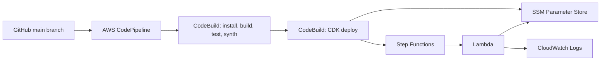

# AWS Serverless Workflow Platform

**Capstone:** Multi-Account, Automated, and Governed Cloud Platform  
**Stack:** AWS CDK (TypeScript), AWS CodePipeline, CodeBuild, Step Functions, Lambda, Systems Manager Parameter Store and CloudWatch.

## Objective

This project provisions a serverless workflow platform using AWS CDK. Step Functions orchestrates the workflow. A Lambda function retrieves a greeting from SSM Parameter Store and writes a structured event to CloudWatch Logs. AWS CodePipeline watches the GitHub `main` branch, runs CodeBuild validation, and deploys the CDK application when changes are pushed.

The lab deployment uses the single AWS Academy account available to the student. The infrastructure is defined as code and can be deployed into another account when a separately provisioned account and appropriate permissions are available. This repository does not claim a completed second-account deployment.

## Architecture



The pipeline is hosted in `eu-west-2` and deploys the application stack in `us-west-2`.

## Main deliverables

- Infrastructure as Code using AWS CDK and TypeScript.
- GitHub-connected CodePipeline with Source, Build and Deploy stages.
- CodeBuild validation and CDK deployment build specifications.
- Step Functions workflow orchestration with retry and failure handling.
- Lambda serverless compute.
- SSM Parameter Store configuration management.
- Least-privilege IAM access to the greeting parameter.
- CloudWatch execution and application logs.
- GitHub Actions validation on pushes and pull requests.

## Repository layout

- `bin/app.ts`: CDK application entry point.
- `lib/workflow-stack.ts`: SSM parameter, Lambda, IAM permissions and Step Functions.
- `lambda/greeting/`: Lambda handler and AWS SDK dependency.
- `test/`: infrastructure assertions.
- `buildspec.yml`: CodeBuild validation, tests and CDK synthesis.
- `deploy-buildspec.yml`: CodeBuild CDK deployment.
- `.github/workflows/ci.yml`: GitHub Actions validation workflow.
- `docs/`: deployment notes and evidence screenshots.

## Deployment and CI/CD

The CodePipeline source stage monitors the `main` branch of this repository through AWS CodeConnections. A push to `main` starts the pipeline:

1. **Source:** retrieves the latest repository revision.
2. **Build:** installs dependencies, compiles TypeScript, runs infrastructure tests and synthesizes the CDK template.
3. **Deploy:** runs `cdk deploy ServerlessWorkflowStack` from CodeBuild, targeting `us-west-2`.

The pipeline itself is hosted in `eu-west-2`. The application stack remains in `us-west-2`. The deployment build specification explicitly sets `CDK_DEFAULT_REGION=us-west-2` to preserve this target.

For an initial/manual application deployment, see [docs/deployment.md](docs/deployment.md).

## Verify the application

1. Confirm Step Functions state machine `serverless-greeting-workflow` exists.
2. Confirm Lambda function `serverless-workflow-greeting` exists.
3. Confirm SSM parameter `/app/config/greeting` exists.
4. Start an execution with:

```json
{
  "source": "manual-capstone-test"
}
```

5. Confirm the execution succeeds.
6. Inspect `/aws/lambda/serverless-workflow-greeting` for the `SSM_PARAMETER_READ` event.

## Security and governance

- Lambda's SSM read permission is scoped to the single greeting parameter.
- The greeting is non-sensitive configuration, not a secret.
- The workflow uses a Standard Step Functions state machine with logging and tracing.
- CloudWatch log groups have one-week retention.
- Pipeline and application changes are version-controlled.
- The available lab account is used for deployment. A second-account deployment is not claimed unless it is actually provisioned and tested.

## Cost control

The project does not create a VPC, NAT Gateway, load balancer or always-on compute. AWS service usage may still incur charges. Review account allowances and remove the lab stack after assessment if instructed.

## Evidence screenshots

Add the actual AWS/GitHub screenshots to `docs/evidence/`:

- `01-codepipeline-success.png`: successful CodePipeline execution showing Source, Build and Deploy.
- `02-step-functions-success.png`: successful Step Functions execution graph.
- `03-lambda-ssm-cloudwatch-logs.png`: Lambda log stream showing the SSM retrieval event.

Do not use mockups or fabricated evidence.

## Submission

https://github.com/RURIGIMK/aws-serverless-workflow-platform
