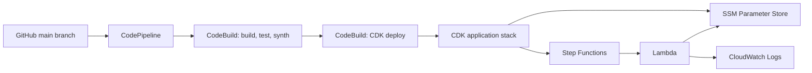
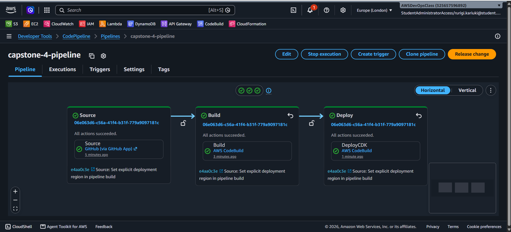
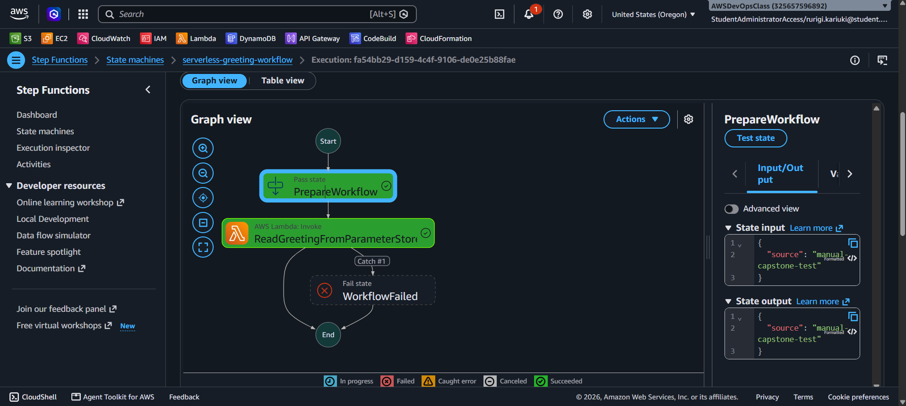
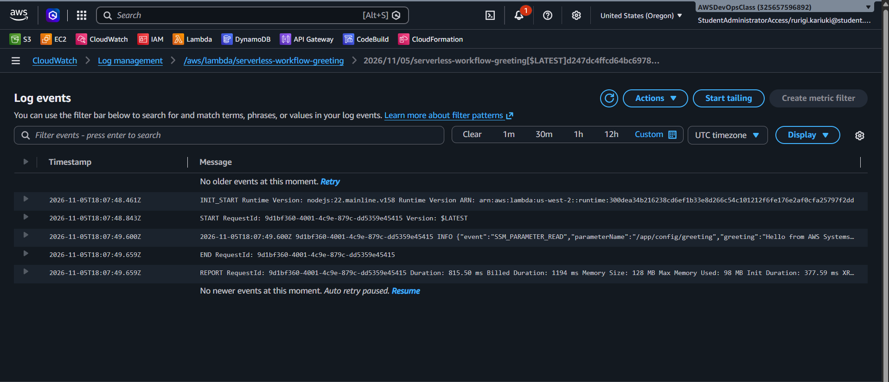

# AWS Serverless Workflow Platform

**Capstone:** Multi-Account, Automated, and Governed Cloud Platform  
**Technology:** AWS CDK (TypeScript), CodePipeline, CodeBuild, Step Functions, Lambda, Systems Manager Parameter Store and CloudWatch

## Overview

This project deploys a serverless workflow with AWS CDK. AWS Step Functions coordinates the execution. A Node.js 22 Lambda function reads a greeting from AWS Systems Manager (SSM) Parameter Store and writes a structured log event to CloudWatch.

The deployment uses the AWS Academy account provided for the lab. That environment exposed one account, so the implementation and evidence demonstrate deployment within that account.

## Architecture



The pipeline runs in **Europe (London), `eu-west-2`**. It deploys the application stack in **US West (Oregon), `us-west-2`**.

## Implementation

### Infrastructure as Code

The CDK stack in `lib/workflow-stack.ts` defines:

- The SSM String parameter `/app/config/greeting`.
- The `serverless-workflow-greeting` Lambda function using Node.js 22.
- A Lambda execution role with read access scoped to the greeting parameter.
- The `serverless-greeting-workflow` Standard Step Functions state machine.
- CloudWatch log groups with seven-day retention.

### Workflow

The state machine runs an initial Pass state followed by the Lambda task. The task retries supported Lambda and timeout errors, then catches remaining failures and routes them to a Fail state.

The Lambda reads `/app/config/greeting` at runtime using the AWS SDK for JavaScript. It logs the parameter name and retrieved value and returns the result to Step Functions.

### CI/CD

The CodePipeline source stage monitors this repository's `main` branch through AWS CodeConnections. A push to `main` starts the pipeline:

1. **Source:** retrieves the latest GitHub revision.
2. **Build:** installs dependencies, compiles TypeScript, runs infrastructure tests and synthesizes the CDK template using `buildspec.yml`.
3. **Deploy:** runs `deploy-buildspec.yml` to deploy `ServerlessWorkflowStack` to `us-west-2`.

The deployment build specification sets `DEPLOY_REGION=us-west-2` so the application is deployed to Oregon regardless of the pipeline's region.

GitHub Actions also builds, tests and synthesizes the CDK application on pushes and pull requests to `main`.

## Repository structure

- `bin/app.ts`: CDK application entry point.
- `lib/workflow-stack.ts`: application infrastructure.
- `lambda/greeting/`: Lambda handler and runtime dependency.
- `test/`: CDK infrastructure tests.
- `buildspec.yml`: CodeBuild validation and synthesis.
- `deploy-buildspec.yml`: CodeBuild deployment.
- `.github/workflows/ci.yml`: GitHub Actions validation.
- `docs/deployment.md`: deployment and verification reference.
- `screenshots/`: execution evidence.

## Verification

The deployed workflow can be started from Step Functions with the following input:

```json
{
  "source": "manual-capstone-test"
}
```

A successful execution returns the parameter name and greeting. The Lambda log group is `/aws/lambda/serverless-workflow-greeting`; successful retrieval is recorded as an `SSM_PARAMETER_READ` event.

## Security and operations

- The Lambda role has parameter-scoped SSM read access.
- The greeting is a non-sensitive String parameter; credentials and secrets are not stored in it.
- Step Functions execution logging and tracing are enabled.
- Lambda and workflow log groups retain events for seven days.
- Infrastructure and application changes are version-controlled.

## Evidence

### CodePipeline



### Step Functions



### Lambda and Parameter Store


